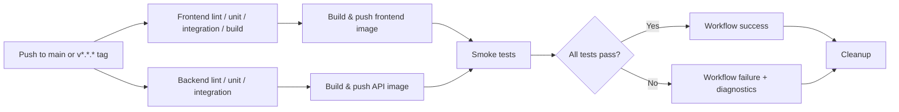

# TaskFlow — CI and Container Publishing

> **Document type:** Engineering runbook and system reference  
> **Owner:** TaskFlow engineering  
> **Status:** Implemented core CI/publishing; some release safeguards remain planned  
> **Last reviewed:** 2026-10-22  
> **Source of truth:** `.github/workflows/ci-workflow.yml` (verify the repository's actual filename before committing) and the repository's Docker Compose configuration  
> **Scope:** Pull-request validation, main-branch validation, container publishing, release-tag handling, and post-publish smoke testing. **Server deployment is not covered or implemented by this pipeline.**

## 1. Purpose

This document explains how TaskFlow validates changes, builds and publishes container images, verifies published images, and investigates failures. It enables engineers to answer:

- Which repository events invoke CI?
- What must pass before images can be published?
- How are commit and release images tagged?
- How can an engineer verify a release or diagnose a failing job?
- What does a successful pipeline prove—and what does it *not* prove?

**Success criteria:** Changes must pass the required validation jobs before image publication; on eligible pushes the published frontend and API images must start together under Docker Compose, pass health checks, serve the web page and route API requests successfully.

## 2. Scope and current state

| Area | Current state | Evidence or caveat |
| --- | --- | --- |
| Frontend lint, unit and integration tests | Implemented | Jobs shown in the successful `v1.0.4` graph |
| Backend lint, unit and integration tests | Implemented | Jobs shown in the successful `v1.0.4` graph |
| Frontend production build | Implemented | `frontend-build` successful |
| Frontend build artifact | Implemented | One workflow artifact in the `v1.0.4` run; artifact names/retention are defined in workflow YAML |
| Docker image builds and pushes | Implemented | `frontend-docker-build` and `backend-docker-build` successful; Docker Hub pull logs |
| Multi-platform Docker builds | Previously implemented | Confirm platform list in Docker build actions before editing this document |
| Main-branch post-publish smoke test | Verified | Healthy services and successful HTTP responses shown in run logs |
| Release-tag smoke test | Verified | `v1.0.4` images, health checks, HTTP responses and cleanup shown in run logs |
| Negative lint/test exercises | Performed | An intentional TypeScript lint error and an intentionally failing HTTP-status assertion were detected |
| Preventing publishing after required job failure | Enforced by `needs` under normal job semantics | Dependency graph supports the configuration; review a failed run for end-to-end proof |
| GitHub workflow token permissions | `contents: read` | Applies to `GITHUB_TOKEN`, not Docker Hub secrets |
| Release immutability policy | Not yet verified | Do not claim immutable Docker tags or protected Git tags |
| Source-revision labels / signed attestations | Not yet verified | SHA-based tags supply basic traceability, not strong provenance |
| Automated staging/production deployment | Not part of this workflow | Future CD work |

**Evidence interpretation:** A green workflow proves that the configured checks passed for that particular run. It does not prove application correctness under all conditions or that already-published image tags can never be overwritten.

## 3. Repository components

```text
TaskFlow/
├── .github/
│   └── workflows/
│       └── ci-workflow.yml        # Confirm filename in the repository
├── api/                         # Node.js backend
├── web/                         # Frontend built for Nginx
├── compose.yaml                 # Confirm filename in the repository
└── docs/
    ├── ci-cd.md
    └── documentation-guide.md
```

The smoke-test stack comprises three Compose services:

| Service | Role | Relevant port |
| --- | --- | --- |
| `mongodb` | Persistent database during the test; ephemeral CI volume | 27017 inside Compose network |
| `api` | Backend API and health endpoints | 3000 inside Compose network |
| `web` | Nginx serving frontend and proxying API traffic | Host `8080` → container `80` |

The API does **not** need a public host-port mapping in CI; the end-to-end API request travels via Nginx.

## 4. Pipeline architecture



> This diagram is logical; independent jobs can execute concurrently. For exact direct edges, use the GitHub Actions run graph or workflow `needs:` configuration.

### 4.1 Why dependencies matter

`jobs.<id>.needs` requires specified prerequisite jobs to succeed before a dependent job runs. If a required job fails or is skipped, downstream jobs are skipped by default, unless conditions override that behavior. This prevents unvalidated changes from reaching a publishing job when all required checks are listed as dependencies.

**Review rule:** A Docker publishing job must list **every check that must gate publishing**, either directly or through a clearly verified dependency chain. Avoid bypass conditions such as `always()` on publishing jobs.

### 4.2 Workflow triggers

The current workflow configuration discussed for TaskFlow is:

```yaml
on:
  push:
    branches:
      - main
    tags:
      - 'v*.*.*'
  pull_request:
    branches:
      - main
```

A Git tag push is reported as event `push`, not `release`. A `pull_request` event has its own ref semantics; it is not a push to `refs/heads/main`.

| Event | Validation | Publish images | Post-publish smoke test |
| --- | --- | --- | --- |
| Pull request targeting `main` | Yes | Should be **disabled**; verify publishing-job `if:` | No |
| Push to `main` | Yes | Yes, if validations pass | Yes, using commit-tag images |
| Push `v1.0.4` | Yes | Yes, if validations pass | Yes, using version-tag images |

**Important:** The smoke-test job's PR condition alone does not stop its upstream publishing jobs. Verify `if:` conditions on `frontend-docker-build` and `backend-docker-build` independently.

## 5. Image names and version rules

| Artifact | Registry image |
| --- | --- |
| Frontend | `hamzaelmkhantar/taskflow-web` |
| API | `hamzaelmkhantar/taskflow-api` |

- **Push to `main`:** the image version is the short Git commit SHA, such as `4c2fd17` (exact length must match publishing jobs).
- **Push to `v1.0.4`:** the image version is `1.0.4`, obtained by removing the leading `v`.
- `latest` may also be pushed depending on publishing-step settings; treat it as mutable, not as a stable release identifier.

The Compose file requires environment variables:

```yaml
services:
  web:
    image: hamzaelmkhantar/taskflow-web:${WEB_VERSION:? WEB_VERSION is required}
  api:
    image: hamzaelmkhantar/taskflow-api:${API_VERSION:? API_VERSION is required}
```

The `:?` syntax makes Compose fail if a required variable is missing or empty. In CI, a version-resolution step writes `API_VERSION` and `WEB_VERSION` to `$GITHUB_ENV`, allowing *subsequent steps in that job*—including diagnostics and cleanup—to reference them.

To inspect the images Compose would select:

```bash
API_VERSION=1.0.4 WEB_VERSION=1.0.4 docker compose config --images
```

**Note:** This displays image *references*, not a guarantee of which digest is running. Inspect resolved image digests/containers when stronger verification is required.

## 6. Pipeline stages

### 6.1 Source validation

Frontend and backend jobs run lint, unit tests and integration tests. The frontend also runs a production build and saves a build artifact. These checks fail the relevant job when its commands return nonzero exit codes.

### 6.2 Image publishing

On eligible pushes, downstream jobs build and push the frontend and API images to Docker Hub after their required validation jobs succeed. The frontend and backend may publish independently; each must be treated as a separate gated artifact. The workflow has previously been configured for `linux/amd64` and `linux/arm64`; verify the present `platforms:` lines if changing them.

**Publishing is not deployment.** Docker Hub receiving an image does not update a VPS or a Docker Swarm service by itself.

### 6.3 Post-publish smoke testing

The `smoke-tests` job depends on both Docker publishing jobs. It:

1. Checks out the repository (including Compose configuration).
2. Resolves an image version from the Git ref and stores it in `$GITHUB_ENV`.
3. Pulls both published images.
4. Starts `mongodb`, `api`, and `web` using Compose.
5. Waits for readiness/health using `docker compose up -d --no-build --wait --wait-timeout 120`.
6. Calls the frontend `/` and the API `/api/tasks` through Nginx on port `8080`.
7. Prints container status and logs if a step failed.
8. Removes disposable containers, CI volume and network using `docker compose down -v --remove-orphans`.

An illustrative HTTP check is:

```bash
curl --fail --silent --show-error http://127.0.0.1:8080/
curl --fail --silent --show-error http://127.0.0.1:8080/api/tasks
```

The final successful run returned the frontend HTML and `[]` from `/api/tasks` (a valid empty task collection). A healthcheck on the Nginx frontend was added or present by the successful run: the logs show `taskflow-web-1 Healthy` before HTTP verification.

**Limitation:** HTTP 2xx by itself does not validate the full response schema or business logic; unit and integration tests provide additional coverage.

### 6.4 Failure diagnostics and cleanup

Use one diagnostics step and one cleanup step **after** both conditional smoke-test branches:

```yaml
- name: Show Docker logs on failure
  if: failure()
  run: |
    docker compose ps
    docker compose logs --no-color --tail=100

- name: Cleanup Docker Compose
  if: always()
  run: docker compose down -v --remove-orphans
```

The `$GITHUB_ENV` variables are accessible in these later steps. The `down -v` command is appropriate **only for disposable CI databases**; do not copy it into production deployment scripts where volumes contain real data.

## 7. Release procedure

### Preconditions

- The intended change is committed and validated on the correct branch.
- The release version has not already been used.
- The two publishing jobs are configured to execute on tag pushes and to use the release-version tag.
- Docker Hub credentials are configured as repository secrets and authorized for publishing.

### Create and push a version tag

```bash
git status
git log -1 --oneline
git tag -a v1.0.5 -m "TaskFlow release v1.0.5"
git push origin v1.0.5
```

> `v1.0.5` is an **example future version**, not a claim that it exists. A tag points to the selected commit; uncommitted changes are not included.

### Verify the run

1. Open GitHub **Actions** and select the run triggered by the tag.
2. Confirm validation jobs passed and image publishing ran only after prerequisites succeeded.
3. Confirm frontend and API images were published under the same version.
4. Confirm smoke tests pulled the intended images, all three services became healthy, and `/` plus `/api/tasks` returned successful responses.
5. Confirm cleanup removed the disposable Compose network, containers and volume.
6. Record the workflow run URL, Git commit SHA, image version and (if needed) immutable digests in release notes.

**Verified example:** The `v1.0.4` run succeeded in 3 minutes 11 seconds. Both `1.0.4` images were pulled; MongoDB, API and Nginx reached `Healthy`; HTTP returned TaskFlow HTML and an empty tasks array; cleanup completed.

### What release success does not mean

- No staging or production server was automatically updated by this workflow.
- A post-publish smoke-test failure does **not** reverse an image already pushed to Docker Hub.
- A mutable tag can later point to a different image unless registry/organizational safeguards prevent it.

## 8. Security and release safeguards

### 8.1 Workflow permissions

The workflow uses:

```yaml
permissions:
  contents: read
```

This constrains GitHub's `GITHUB_TOKEN`. It does **not** make `DOCKER_USERNAME`/`DOCKER_PASSWORD` read-only. Keep write-capable registry credentials in publishing jobs only; where smoke tests require login, consider a distinct pull-only credential or remove login when public-image anonymous pulling is sufficient.

Avoid exposing secrets to untrusted PR code; use job-level event guards and carefully review PR triggers. Do not use `pull_request_target` casually for builds of untrusted code.

### 8.2 Release immutability — pending policy

Never intentionally reuse `v1.0.4` for different source content. Consider Git tag protections and registry-side immutable tag controls where available. For stronger deployment reproducibility, record and deploy immutable image digests (`@sha256:...`) rather than relying exclusively on tag names.

### 8.3 Traceability — basic now, enhanced later

Short-SHA image tags provide a useful source-linking convention. Add OCI metadata such as `org.opencontainers.image.source`, `org.opencontainers.image.revision`, and `org.opencontainers.image.version` to support image inspection. Build provenance/signing can be introduced separately; do not assert they are currently enforced without verifying action settings and attestations.

### 8.4 Dependency and failure verification

The successful Actions graph confirms the required dependency connections. Earlier negative exercises verified individual validation failures. To verify *propagation*, inspect those runs and check that dependent publishing jobs were skipped. The screenshot of a successful run alone does not prove the failure path.

## 9. Troubleshooting runbook

| Symptom | Likely causes | First checks |
| --- | --- | --- |
| Docker publishing skipped | A required validation failed/skipped; job `if:` excluded the event | Inspect run graph, `needs:`, step conditions |
| API image published but web not visible yet | Web job still running, push error, differing tag | Check frontend publish job result and Docker Hub tag list |
| Image pull fails | Tag mismatch, missing artifact, registry login or visibility | Print resolved version; check `docker compose config --images` and pull log |
| Compose says a version is required | Missing `API_VERSION` / `WEB_VERSION` | Confirm `$GITHUB_ENV` writes ran before Compose step |
| Containers start but `curl` gets connection reset | Nginx not yet ready, container restart, network issue | Check `docker compose ps`, Nginx logs and frontend healthcheck |
| MongoDB healthy but API unhealthy | API startup/config/db readiness | Check API logs and `/health/ready` from appropriate network context |
| `/` works but `/api/tasks` fails | Nginx reverse-proxy routing or API request handling | Check Nginx config and API logs; test container-to-container connectivity |
| Cleanup fails | Missing environment variables or Compose config; Docker error | Check `$GITHUB_ENV`, Compose config and `docker compose ps` |
| Smoke test fails after push | Published image may already exist | **Do not deploy it**; investigate, correct and publish a new version |

### Lessons learned from an actual TaskFlow failure

An earlier smoke run returned `curl: (56) Recv failure: Connection reset by peer` immediately after the frontend was merely `Started`. Diagnostic logs showed Nginx initializing. A later passing run showed all three services `Healthy` before HTTP requests. This illustrates the difference between a container being started and an application being ready. Favor a meaningful healthcheck plus bounded readiness waiting; optional retrying probes add resilience.

## 10. Maintenance and ownership

Update this document in the same pull request whenever changing:

- Workflow triggers, job IDs, `needs:` or publication conditions.
- Image names, tag rules, supported architectures or credentials.
- Compose service names, exposed ports, healthchecks or smoke endpoints.
- Release procedure, verification or incident-handling steps.

**Change review checklist:** Are all commands runnable? Are placeholders identified? Are statements about implementation supported by YAML or run logs? Are credentials omitted? Does the runbook explain failure diagnosis and recovery? Is the next engineer able to release without relying on oral instructions?

## 11. Next phase: Continuous Deployment (planned)

After the CI/publishing baseline is accepted, implement a **separate staging deployment flow**: provision a staging VPS, deploy pinned image versions/digests, maintain configuration and secrets outside images, verify health after deployment, define rollback procedures, and then consider Docker Swarm and monitoring. Do not describe this as already implemented.

## 12. References

- [GitHub Actions workflow syntax and `needs`](https://docs.github.com/en/actions/reference/workflows-and-actions/workflow-syntax)
- [GitHub Actions contexts](https://docs.github.com/en/actions/reference/workflows-and-actions/contexts)
- [GitHub Actions workflow commands and `$GITHUB_ENV`](https://docs.github.com/en/actions/reference/workflows-and-actions/workflow-commands)
- [Docker Compose `up` (`--wait` / `--wait-timeout`)](https://docs.docker.com/reference/cli/docker/compose/up/)

---

**Document verification status:** Based on supplied CI runs, workflow snippets and run-graph screenshot as of 2026-10-22. Before committing, reconcile the exact workflow/Compose filenames, platform values, artifact retention and publishing-job PR conditions with the live repository YAML.
